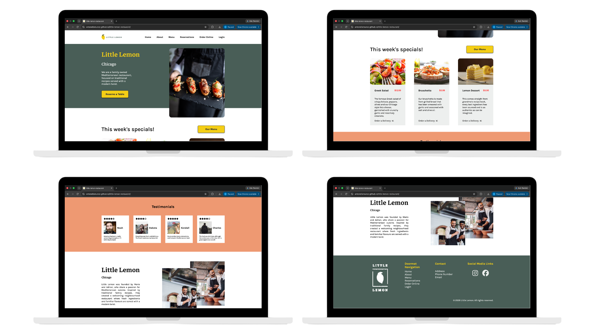
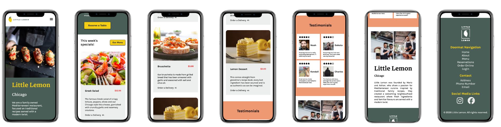

# Little Lemon Restaurant App

This project was completed as part of the **Front-End Developer Capstone** course within the **Meta Front-End Developer Professional Certificate** on Coursera.

It consists of a responsive restaurant website built with React, JavaScript, HTML5, and CSS3. The application includes a homepage featuring restaurant information, highlighted dishes, and customer testimonials; a booking page where users can reserve a table by selecting a date, an available time, the number of guests, and an occasion; and a confirmation page displaying the reservation details after a successful booking submission.

The course provided the project requirements and guidance, while I independently developed the application from scratch, including its structure, components, styling, booking functionality, and testing, without using any starter code.

Although the course suggested using Create React App, I decided to use Vite as the development and build tool, considering the official deprecation of Create React App in February 2025. This allowed me to follow the course requirements while adopting a more modern development workflow aligned with current React practices.

## Table of Contents

- [Overview](#overview)
  - [Screenshots](#screenshots)
  - [Links](#links)
- [My Process](#my-process)
  - [Built With](#built-with)
  - [What I Learned](#what-i-learned)
  - [Continued Development](#continued-development)
  - [Useful Resources](#useful-resources)
- [Author](#author)

## Overview

### Screenshots

#### Desktop

#### Mobile

### Links

- GitHub Repository URL: [GitHub Repository](https://github.com/antonellamunoz/little-lemon-restaurant)
- Live Site URL: [GitHub Pages](https://antonellamunoz.github.io/little-lemon-restaurant/)

## My Process

### Built With

- React
- JavaScript (ES6+)
- HTML5
- CSS3

### What I Learned

This project strengthened my understanding of React through the development of a restaurant booking application. I gained practical experience with component-based architecture, reusable components, React hooks, client-side routing, form validation, API integration, accessibility, responsive design, and testing.

I organised the application into separate components for the header, navigation, footer, homepage sections, the booking page containing the reservation form, and the confirmation page. I also created reusable FoodCard and ReviewCard components, passing content through props and using JavaScript's .map() method to render multiple instances dynamically rather than hardcoding repeated elements. This helped me better understand component reusability and how to structure maintainable React applications. I also worked with React Router's BrowserRouter, Routes, Route, and Link to implement navigation between the application's pages.

One of the most important parts of the project was implementing the table reservation system. I used useState to manage form inputs and useReducer to manage the available reservation times, integrating the provided fetchAPI() function and JavaScript's Date object to retrieve times according to the selected date. I implemented onChange event handlers to update the form's state based on user input and dispatch changes to the available reservation times.

I implemented client-side form validation and error prevention using HTML validation attributes and React hooks. This included applying constraints such as restricting time selection to the available reservation slots retrieved for the selected date, as mentioned earlier, and preventing users from selecting past dates, while also providing validation feedback. To restrict past dates, I used the JavaScript Date object to retrieve the current year, month, and day, formatting the values with padStart() to create the YYYY-MM-DD string required by the date input's min attribute.  I also used useRef to access the form element and useEffect to check its validity whenever relevant input values changed, dynamically enabling or disabling the submit button based on the result. Additionally, I used the onBlur event handler to update the guestsTouched state when users left the number-of-guests field. I combined this with conditional rendering to display an error message if the entered value was outside the permitted range of 1–10 guests.

For the booking submission, I integrated the provided submitAPI() function and used React Router's useNavigate() hook to redirect users to the confirmation page after a successful submission. I passed the reservation details through navigation state and retrieved them using useLocation(), allowing the confirmation page to display the submitted information dynamically.

Accessibility was another important part of the project. I reviewed the application's semantic HTML, heading structure, form labels, image alt text, and interactive elements, implementing attributes such as aria-label, aria-labelledby, aria-describedby, and aria-hidden where appropriate. I also worked with keyboard navigation, focus indicators, and accessible descriptions for non-text content, gaining a better understanding of how to make interfaces usable beyond their visual appearance.

I gained further experience with CSS and responsive design, using Flexbox, CSS Grid, media queries, and responsive dimensions to adapt the application's layout across different screen sizes. I also worked with pseudo-classes, dynamic styling, and visual feedback for interactive elements.

I also configured HTML metadata and Open Graph tags to improve how the website is presented when shared online. Separately, I added a favicon to display the restaurant's icon in browser tabs.

I strengthened my understanding of unit testing and usability evaluation by writing unit tests using Vitest and React Testing Library to verify booking form validation, submit-button states, and available reservation times. I also evaluated the application against Nielsen's 10 usability heuristics.

## Continued Development

Through future projects, I would like to continue consolidating my understanding of React by applying the knowledge and skills I have acquired so far. I also want to explore more advanced concepts, tackle more complex challenges, and discover alternative approaches to implementing the functionality I developed in this project.

## Useful Resources

- [React Router - Routing](https://reactrouter.com/start/declarative/routing) - A reference for implementing client-side routing and navigation between application pages.

- [Coursera - Advanced React](https://www.coursera.org/learn/advanced-react/home/module/1) - This course helped me deepen my understanding of React concepts and explore different approaches to building and managing components.

- [React – useReducer](https://react.dev/reference/react/useReducer) – A useful reference for understanding reducer-based state management and dispatching actions to update application state.

- [W3C – Understanding WCAG 2.2](https://www.w3.org/WAI/WCAG22/Understanding/) – A reference for understanding web accessibility guidelines, including semantic HTML, keyboard navigation, focus indicators, colour contrast, form accessibility, and alternative text for images.

These are just a few of the resources I used to deepen my understanding of React and web development concepts and apply them throughout this project.

## Author

- GitHub - [@antonellamunoz](https://github.com/antonellamunoz)
- LinkedIn - [Antonella Muñoz](https://www.linkedin.com/in/antonella-m-723b2014a/)

